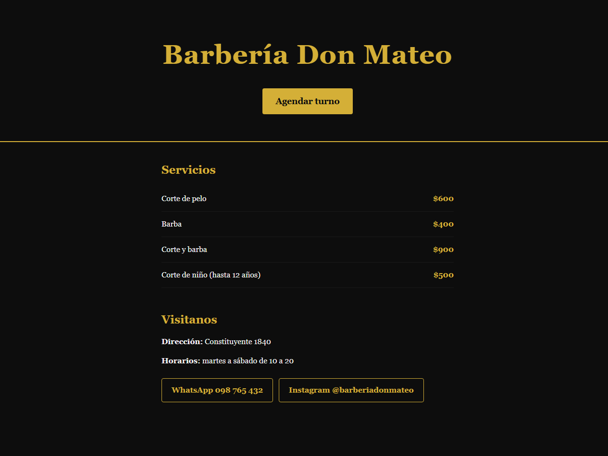
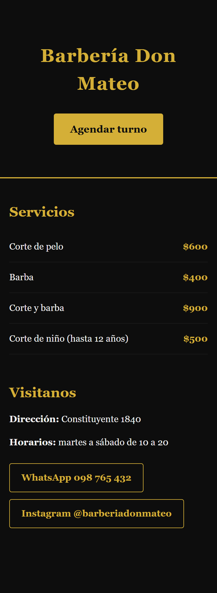

# Ejemplo: Barbería Don Mateo

Una web de una página para una barbería de barrio: los servicios con sus precios y un botón para agendar turno. Hecha con el Método CDIA en 4 comandos y unos 4 minutos de trabajo de Claude.

Es una corrida real del plugin con Claude Sonnet. Las respuestas del alumno las dio un alumno simulado con los datos del negocio, para poder repetir la prueba. El negocio es inventado.



## El pedido

> quiero una web para una barbería con los servicios y para que los clientes agenden turno

## Paso por paso

### 1. `/cdia:empezar`

Claude miró la carpeta (vacía), clasificó el pedido como sistema nuevo y cerró con el comando siguiente ya armado:

```
Siguiente: /cdia:brainstorming quiero una web para una barbería con los servicios y para que los clientes agenden turno
```

### 2. `/cdia:brainstorming` · modo Plan

Tres preguntas, las que cambian qué se construye:

1. **¿Qué contenido real tiene ya la barbería?** Servicios con precios, dirección, horarios, WhatsApp, Instagram. Sin fotos ni logo, así que la web va sin fotos.
2. **¿Qué tienen armado en GoHighLevel?** Ya tienen el calendario de turnos. Entonces el botón lleva a ese calendario y no se construye un sistema de turnos.
3. **¿Los turnos tienen que dejar algún aviso?** No: los recordatorios los manda GoHighLevel.

Con eso escribió el [SPEC.md](proyecto/SPEC.md): 6 requisitos en "Entra", una lista de "No entra" y una sola fase.

| Entra | No entra |
|---|---|
| Nombre, botón "Agendar turno", negro y dorado | Fotos, galería y logo |
| Servicios con precio | Un sistema de turnos propio |
| El botón lleva al calendario de GoHighLevel | Avisos y recordatorios |
| El link del calendario en un solo lugar | Pagos, login y panel |
| Dirección, horarios, WhatsApp e Instagram | Mapa, reseñas, blog, más secciones |
| Se ve bien en celular y compu | Idiomas y estadísticas |

### 3. `/cdia:fase` · modo Auto o Accept edits

Antes de construir pidió lo único que le faltaba: la lista de servicios con precios. No inventó ninguno.

Construyó dos archivos: [index.html](proyecto/index.html) (43 líneas) y [styles.css](proyecto/styles.css) (85 líneas). Sin base de datos, sin servidor, sin dependencias.

El alumno le pasó también la duración de cada servicio. Como el SPEC pedía solo nombre y precio, Claude no la mostró y la anotó en "Ideas para después".

### 4. `/cdia:probar`

Abrió la página en Chrome, en ancho de compu y de celular, y recorrió los 6 requisitos:

- 5 en ✅.
- 1 en ⚠️: el botón "Agendar turno" apunta a un link de prueba, porque el link real del calendario todavía no estaba.



## Qué falta para entregarla

1. Pegar el link real del calendario de GoHighLevel en el `href` del botón, marcado con un comentario en `index.html`.
2. `/cdia:publicar`: sube el código a GitHub y publica en Vercel. Ese paso lo escribe la persona.

## Qué muestra este ejemplo

- **"Agendar turno" no significó construir un sistema de turnos.** El negocio ya tenía el calendario en GoHighLevel: se conecta, no se vuelve a construir.
- **Lo que no se pidió quedó escrito en "No entra"** y no apareció en el código.
- **Lo que surgió en el camino** (la duración de los servicios) fue a "Ideas para después", no a la página.
